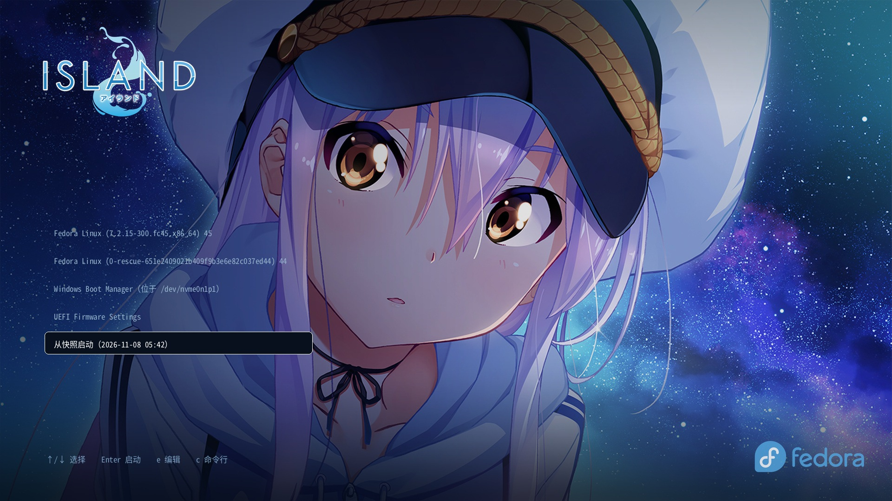
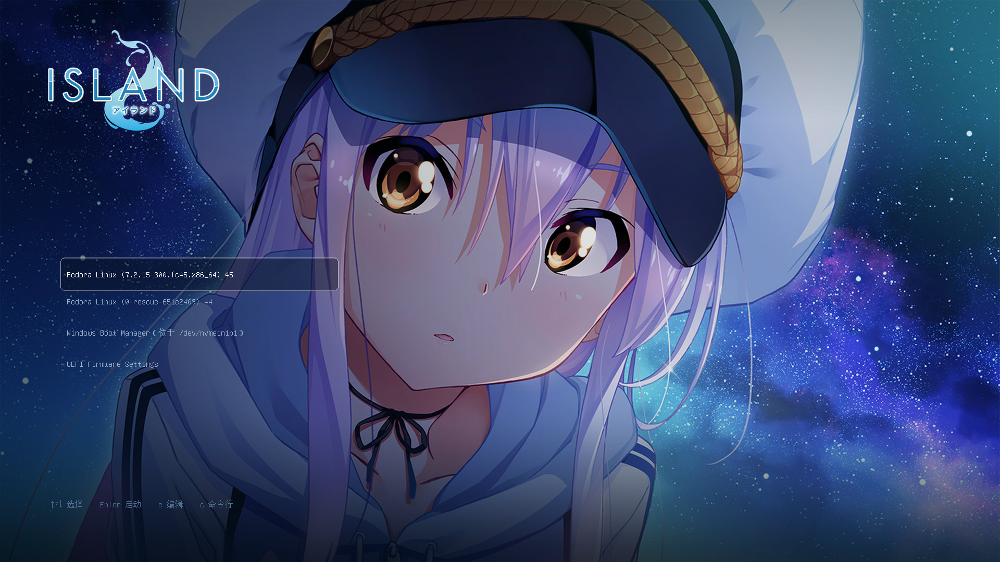
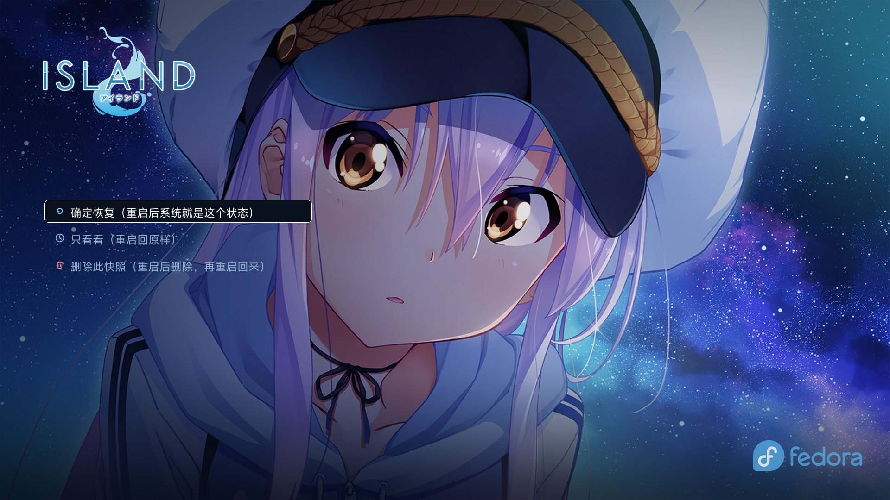
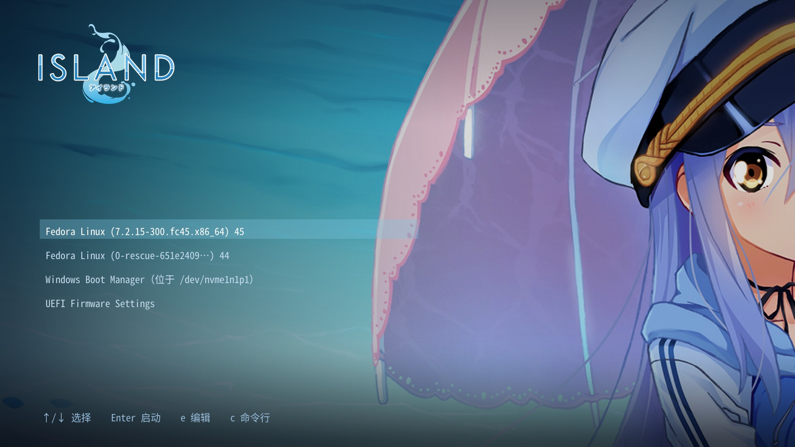
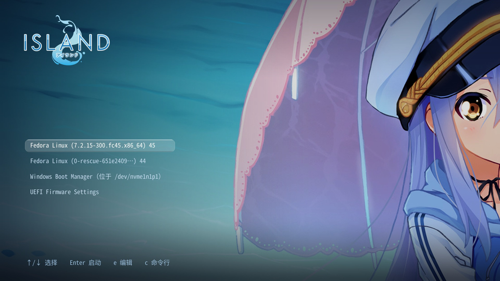

<div align="center">

# grub-theme-rinne

**ISLAND 风格的 GRUB 2.12 主题 · 深色星空 + btrfs 快照三层菜单**

[](LICENSE)
[](https://www.gnu.org/software/grub/)
[](#)
[](#)
[](#)
[](CONTRIBUTING.md)

</div>

---



> 背景图与 ISLAND 标识为 Frontwing 官方素材，仅作示例。Fedora 标识归 Red Hat 所有。

名字取自《ISLAND》的女主角 **凛音（Rinne）**。

**只在 Fedora 45 上实测过。** 其他发行版能否用，取决于 GRUB 版本和分区布局，参见 [已知限制](#已知限制)。

---

## 目录

- [特点](#特点)
- [快速安装](#快速安装)
- [效果](#效果)
- [快照方案（可选）](#快照方案可选)
- [这个项目怎么来的](#这个项目怎么来的)
- [那一夜，六个坑（插画）](#那一夜六个坑插画)
- [已知限制](#已知限制)
- [依赖与致谢](#依赖与致谢)
- [支持原作](#支持原作)
- [⚠️ 先读这个](#️-先读这个)
- [License](#license)

---

## 特点

| | |
|---|---|
| 🖼 **1920×1080 星空背景** | 左侧渐变压暗，保证菜单文字可读 |
| 🔲 **九宫格高亮条** | 暗色半透明填充 + 白边，在亮背景上也不糊 |
| 🈶 **中文不乱码** | 用系统自带的 `unicode.pf2`（GNU Unifont），全 BMP 覆盖 |
| 📚 **三层菜单** | 主菜单 → 快照列表 → 单个恢复点 |
| 💾 **快照直接启动** | 不用进系统，GRUB 里就能启动到任意快照 |
| ⏪ **拍 / 删 / 恢复** | 三个动作都能在 GRUB 菜单里触发 |

---

## 快速安装

```bash
git clone https://github.com/SilverKurali/grub-theme-rinne.git
cd grub-theme-rinne

sudo mkdir -p /boot/grub2/themes/rinne
sudo cp theme/* /boot/grub2/themes/rinne/

# 写入配置
echo 'GRUB_THEME="/boot/grub2/themes/rinne/theme.txt"' | sudo tee -a /etc/default/grub
sudo sed -i 's/^GRUB_TERMINAL_OUTPUT=.*/GRUB_TERMINAL_OUTPUT="gfxterm"/' /etc/default/grub
sudo sed -i 's/^GRUB_TERMINAL_INPUT=.*/GRUB_TERMINAL_INPUT="console"/' /etc/default/grub
grep -q '^GRUB_GFXMODE=' /etc/default/grub || echo 'GRUB_GFXMODE=1920x1080,1280x720,auto' | sudo tee -a /etc/default/grub

sudo grub2-mkconfig -o /boot/grub2/grub.cfg
sudo reboot
```

**只想要主题、不要快照功能的话，到此为止。**

**换背景**：把任意 1920×1080 的 PNG 命名成 `background.png` 覆盖 `theme/background.png` 即可。JPEG 也能用（改 `theme.txt` 里的 `desktop-image`），但 PNG 解码更稳。

### 关于 `theme/original/` 里的官方原图

`screenshots/pixmaps-source/` 里是九宫格切片的原始小图（32×32），可以对照 `theme/select_*.png` 看切法。

| 文件 | 尺寸 | 来源 |
|---|---|---|
| `official-hero-1920x620.jpg` | 1920×620 | Steam 库页面横幅 |
| `official-keyvisual-1438x810.jpg` | 1438×810 | Steam 商店页背景 |
| `official-logo.png` | 588×345 RGBA | 官网 logo |
| `official-icon-256.png` | 256×256 RGBA | 游戏图标 |
| `composite-background.jpg` | 1920×1080 | 合成后的成品（= `theme/background.png` 的 JPEG 版） |

**这两张原图不能直接做 GRUB 背景**：1920×620 是 3.1:1，塞进 16:9 必然要么裁掉角色的脸、要么上下留黑边；1438×810 比例对了但分辨率不够 1920×1080。

`background.png` 是在 `official-keyvisual-1438x810.jpg` 基础上做的：放大到 1920×1080 → 左侧加暗色渐变 → 左上角叠官方 logo → 右下角叠 Fedora wordmark。

---

## 效果

**真机启动截图**（QEMU + OVMF 跑的真 GRUB 2.12，不是模拟渲染）：



**三层菜单：**

| 主菜单 | 快照列表 | 恢复点 |
|---|---|---|
|  |  |  |

**只换背景、不装快照方案**的样子：



**九宫格高亮条特写**（暗色填充 + 白边）：



---

## 快照方案（可选）

`scripts/` 里是一套让 GRUB 能直接启动 btrfs 快照的东西：

| 文件 | 作用 |
|---|---|
| `40_custom` | 放进 `/etc/grub.d/`，`grub2-mkconfig` 时扫描 `/snapshots/` 生成三层菜单 |
| `01_gfxpayload` | `set gfxpayload=keep`，必须在 `blscfg` 之前 |
| `snapshot.sh` | 拍快照：只读恢复点 + 可写副本 + 试验副本 |
| `rollback.sh` | 命令行回滚 |
| `island-snapshot-wizard` | 开机向导（zenity），从恢复点启动后询问是否永久恢复 |
| `island-boot-action` | GRUB 里选「拍 / 删快照」后的开机执行器 |
| `island-fstab-patch.py` | 改 fstab 里 `/` 行的 `subvol=` |
| `island-snapshot-wizard.desktop` | 自启动项（只在快照里触发，正常系统不弹窗） |
| `island-bls-titles` | 把 BLS 里的英文标题改回中文（可选） |
| `island-bls-titles.path` + `.service` | systemd 监控单元，内核升级后自动触发上一条 |
| `island-boot-action.service` | systemd 单元，配合 `island-boot-action` |

**装之前先读 [docs/PITFALLS.md](docs/PITFALLS.md)**，那里面全是踩过的坑，能省几个小时。

> **`island-bls-titles` 是可选组件。** Fedora 每次内核升级都会把 `Fedora Linux 45（正常启动 · 7.2.15）` 重写成英文的 `Fedora Linux (...) 45 (Workstation Edition)`。装了这个 path unit 就会自动改回中文；不装也能用，只是升级后要手动改一次。详见 [docs/INSTALL.md](docs/INSTALL.md#可选让-fedora-的菜单标题一直是中文)。

---

## 这个项目怎么来的

**全部由 DeepSeek-V4.1-Flash 写成，人类只负责说"不对，再来一次"。**

| | |
|---|---|
| 模型 | DeepSeek-V4.1-Flash |
| 实际消耗 | 约 **2.15 亿 token** |
| 本应该消耗 | 不到十分之一 |

**为什么差了这么多**

代码本身不复杂——一个 `theme.txt`、几百行 GRUB 脚本、几个 systemd 单元。真正烧掉 token 的是**试错**：

- 黑框问题猜错方向改了三次，前两次改完重启，还是黑框
- 把 `GRUB_TERMINAL_INPUT` 从 `console` 改成 `at_keyboard`，键盘直接失灵，人被困在菜单里只能等超时
- `/etc/grub.d/` 里留了两个 `.bak` 备份文件，`grub2-mkconfig` 把它们当脚本执行，菜单里「从快照启动」出现两遍
- QEMU 验证用的虚拟机在后台跑了七分钟没人管，占 93% CPU，风扇狂转
- 九宫格切片的边尺寸和圆角尺寸不一致，边框在两端断开
- `title-text` 被当成合法 theme 属性写进去，整个主题加载失败

这些在 `docs/PITFALLS.md` 里都记着，一共 24 条。

**所以这个仓库的价值不只是主题本身**——还把那些"看起来对、实际错"的坑标出来了。你要重做一遍，能省掉大部分弯路；你要是直接抄，能省掉全部。

---

## 那一夜，六个坑（插画）

那十六小时里真正塌掉的六次，画成了六张图。

[](docs/STORY.md)

**[→ 去看那一夜发生了什么](docs/STORY.md)**

<sub>六张插画由 SenseNova 生成，文案由 DeepSeek-V4.1-Flash 写。这是它在这个仓库里留下的唯一的"自述"。</sub>

---


## 已知限制

**启动瞬间会有个黑框** — `console` 输入终端自带的 VGA 文本窗口。换成 `at_keyboard` 能消掉，但 UEFI 机器上键盘会失灵。**二者只能选一个。**

**GRUB 不能写 btrfs 元数据** — 所以「拍快照 / 删快照」实际是「启动 → 脚本执行 → 自动重启」，会看到两次开机。

**GRUB 运行时不展开 glob** — 快照列表必须在 `grub2-mkconfig` 时生成。

**没有主题包管理** — 换主题只能手动改 `GRUB_THEME`。

---

## 依赖与致谢

**这个仓库真正包含的第三方代码/资源，只有一个字体：**

| 项目 | 用在哪 | 许可 | 是否包含在仓库里 |
|---|---|---|---|
| [**GNU Unifont**](https://unifoundry.com/unifont/) | `theme/unicode.pf2`（中文字体） | GPLv2 + 字体嵌入例外 | ✅ 是，原样包含 |

**运行环境（不包含在本仓库里，系统自带）：**

| | 版本 | 说明 |
|---|---|---|
| [GRUB](https://www.gnu.org/software/grub/) | 2.12 | 主题引擎本身 |
| [btrfs-progs](https://btrfs.readthedocs.io/) | 任意 | 快照功能需要 |
| [zenity](https://gitlab.gnome.org/GNOME/zenity) | 任意 | 开机向导的对话框（仅快照方案需要） |

**构建时用过、但不在仓库里：**

- [Pillow](https://python-pillow.org/) — 生成九宫格 pixmap 和背景图合成，仅作者本地用过，仓库里只有生成好的 PNG

**没有使用的：** `grub-btrfs`、`grub-customizer` 等同类工具。快照菜单的 `40_custom` 是从零写的，没有参考它们的代码。如果你在网上看到类似实现，那是巧合——GRUB 的菜单语法本来就这么几种写法。

---

## 支持原作

这个主题用的背景图来自《ISLAND》。如果它让你想起了那座岛，请去支持一下原作。

| | 链接 |
|---|---|
| **Steam**（游戏，官方中文） | https://store.steampowered.com/app/857450/ |
| **官方网站**（游戏 + 动画） | http://never-island.com/ |
| **角色介绍** | http://never-island.com/character |
| **商品 / 周边** | http://never-island.com/product/product.html |
| **周边商店**（Anime Store.JP） | https://anime-store.jp/ |
| **Frontwing 官网** | https://www.frontwing.jp/ |

《ISLAND》2016 年 4 月 28 日由 Frontwing 发售，2018 年 7 月动画化。凛音（御原 凛音）的 CV 是田村ゆかり。

**这个仓库不含任何游戏资源。** 背景图仅作主题示例，版权归 Frontwing 所有。想长期用，请自己买一份游戏，或者换一张自己的图。

---

## ⚠️ 先读这个

**这套东西会改你的引导流程。改坏了，电脑就开不了机。**

完整的风险说明、真实事故清单、责任划分，见 **[DISCLAIMER.md](DISCLAIMER.md)**。

关于背景图的版权立场（非官方 / 非商业 / 引用性质 / 24 小时下架承诺），在 **[COPYRIGHT.md](COPYRIGHT.md)**。

**欢迎 PR / issue / fork** —— 前提是不涉及任何商业行为。详见 **[CONTRIBUTING.md](CONTRIBUTING.md)**。

**三个硬性前提：**

1. **先备份** — `sudo btrfs subvolume snapshot -r / /snapshots/before-theme` 或整盘备份
2. **有 Live USB** — 万一 GRUB 坏了，只有它能救
3. **知道自己的根分区 UUID** — `lsblk -f` 看一眼

**三条里有一条不满足，请先别往下装。**

---

## License

**PolyForm Noncommercial 1.0.0** — 仅限个人学习、研究、自用。

| | |
|---|---|
| ✅ | 自己用、改、分享给朋友 |
| ✅ | 研究 GRUB 主题怎么写 |
| ✅ | 在个人博客 / 视频里展示和讲解 |
| ❌ | 商业用途（卖给客户、打包进产品、收费安装） |
| ❌ | 公司内部部署 |
| ❌ | 以营利为目的的服务 |

完整条款见 [LICENSE](LICENSE)，第三方素材例外见 [NOTICE.md](NOTICE.md)。

**特例：**

| 文件 | 许可证 |
|---|---|
| `theme/unicode.pf2` | GNU Unifont，GPLv2 + 字体嵌入例外（保持原许可） |
| `theme/background.png`、`theme/original/*` | 《ISLAND》官方素材，版权归 Frontwing。仅作示例，**禁止商业使用**。要再分发或商用请先换成自己的图。完整立场见 [COPYRIGHT.md](COPYRIGHT.md) |

**想商用怎么办**：把 `theme/background.png` 换成你自己的图，`theme.txt` 和九宫格 pixmap 是我写的，那时可以来找我谈授权。

---

<div align="center">

**如果这个主题让你的开机界面好看了一点，那就够了。**

</div>
